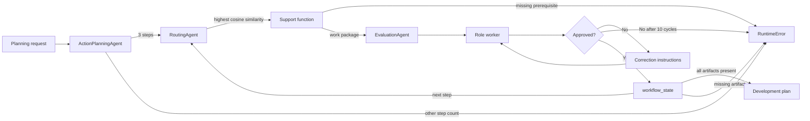

# Project Planning Agents

A multi-agent planning workflow in which no artifact moves forward until an
evaluator approves it: role-specific agents draft user stories, features, and
engineering tasks, and each draft is checked and revised before the next role
builds on it.

| | |
| --- | --- |
| **Problem** | LLMs produce planning documents that look complete but may drift from the source specification, skip required fields, or ignore earlier decisions. |
| **Approach** | Step decomposition, embedding-based routing to role agents, self-contained work packages that carry approved upstream artifacts, and a bounded worker/evaluator (LLM-as-a-judge) revision loop that gates every artifact. |
| **Results** | 5 offline tests pass with every model call mocked, covering semantic routing, evaluator-driven revision, RAG chunking, and state handoff between roles. |
| **Stack** | Python · OpenAI API · Embedding-based routing · LLM-as-a-judge · NumPy · pandas · uv |

## Overview

Given a product specification and a planning request, the workflow produces a
consolidated text development plan with three sections: user stories, product
features, and engineering tasks. The integrated run in
`email_router/agentic_workflow.py` uses a sample product specification (Email
Router) that describes an AI email triage product. The repository implements
the planning workflow only; it does not implement an email-routing service,
and the KPI figures in the specification are illustrative targets, not
measured results.

The engineering problem is not writing user stories; it is keeping a chain of
LLM calls consistent when each stage depends on the output of the one before
it. The decompose → route → generate → evaluate → hand off pattern is intended
to generalize to other workflows where several specialist roles contribute to
one document and each contribution must be checked before others rely on it;
only the planning workflow is implemented here.

## How it works



1. **Plan.** `ActionPlanningAgent` is prompted to return exactly three
   ordered steps (create user stories, group them into features, create
   engineering tasks); the workflow rejects any other step count.
2. **Route.** `RoutingAgent` embeds each step, compares it with the Product
   Manager, Program Manager, and Development Engineer route descriptions, and
   calls the closest route's support function.
3. **Generate.** The support function builds a work package containing the
   step, the full specification, every approved upstream artifact, and the
   role's own previously completed work, then hands it to the role's
   `EvaluationAgent`, which calls a `KnowledgeAugmentedPromptAgent` worker to
   draft the artifact.
4. **Evaluate.** `EvaluationAgent` asks the model for a Yes/No verdict against
   role-specific criteria. On No, the model writes correction instructions
   and the worker revises, for up to `MAX_EVALUATION_INTERACTIONS = 10`
   cycles.
5. **Consolidate.** Approved text is appended to `workflow_state`; after all
   three steps, the workflow checks that every artifact list is non-empty and
   returns the combined plan.

## Key design decisions

- **Every artifact passes a gate before it is reused.** Downstream roles
  receive only evaluator-approved stories and features, so a rejected draft
  cannot propagate into later stages.
- **Self-contained work packages.** Each role receives the step, the full
  specification, and the approved upstream artifacts in one prompt, which
  makes every handoff explicit and inspectable instead of relying on hidden
  conversation history.
- **Role-specific acceptance criteria.** User stories must follow the
  "As a [type of user], I want ... so that ..." form; features and tasks must carry
  named fields such as `Feature Name`, `Related User Story`, and
  `Acceptance Criteria`; all three are checked for grounding in the
  specification.
- **Bounded revision.** A rejected response is revised with explicit
  correction instructions, and the loop raises `RuntimeError` after its cycle
  limit rather than returning an unapproved draft.
- **Fail closed on missing prerequisites.** The workflow raises if the planner
  does not return three steps, if features are requested before stories
  exist, if tasks are requested before stories and features exist, or if any
  artifact list is empty at the end.
- **Reusable agent library.** `workflow_agents/base_agents.py` provides seven
  agents (direct, persona-augmented, knowledge-augmented, RAG, evaluation,
  routing, and action planning), four of which (action planning, routing,
  knowledge-augmented, evaluation) the workflow composes; the `examples/`
  scripts exercise each one individually.

## Results

No model output, transcript, or quality measurement from the current code is
saved in the repository, so nothing about plan quality is claimed as measured.
The reproducible evidence is the offline test suite, which mocks every model
call. Running the suite locally on Python 3.13.3 gives 5 passed across
`tests/test_base_agents.py` and `tests/test_agentic_workflow.py`, verifying
that:

- two consecutive workflow runs reset state, and downstream work packages
  carry the approved upstream stories and features;
- `EvaluationAgent` revises a rejected response with correction instructions
  and accepts it on the second cycle;
- `RoutingAgent` dispatches to the route with the highest cosine similarity
  for fixed test embeddings; and
- the RAG chunker persists a CSV chunk store, and cosine similarity returns
  1.0 for aligned and 0.0 for orthogonal vectors.

## Limitations

- Artifacts are free-form text, not structured schemas; field-label
  compliance is enforced only by the LLM evaluator, and acceptance is a
  check that the verdict starts with "yes". Structured output schemas would
  let code verify each field directly.
- Routing uses embedding similarity alone, with no threshold or calibration
  set, so a step can be misrouted, which halts the run at a prerequisite
  guard or at the final artifact check rather than being re-routed. Route
  descriptions are re-embedded on every call, and the embedding model is
  fixed to `text-embedding-3-large`.
- Each evaluation cycle can take up to three model calls, and only the cycle
  limit bounds cost and latency. There is no application-level retry policy
  beyond the OpenAI SDK's default retries, and no persistence,
  observability, human approval step, or CI.
- The tests mock all model calls, and the workflow test replaces semantic
  routing with a dictionary lookup, so real routing of the three roles and
  real output quality are untested.
- This is a prototype of a planning workflow, not a deployed planning
  service.

[docs/architecture.md](docs/architecture.md) covers the core agents'
responsibilities, state handoff, failure handling, and notes on production
hardening.

## Running locally

Requires Python 3.13+, [uv](https://docs.astral.sh/uv/), and an
OpenAI-compatible endpoint that serves the chosen chat model and the
`text-embedding-3-large` embedding model. The workflow and most examples
send `reasoning_effort`, so the chat model must accept it.

```bash
uv sync --locked
cp .env.example .env          # then fill in OPENAI_API_KEY and OPENAI_BASE_URL
uv run python -m unittest discover -s tests -v
```

The test suite needs no credentials. `OPENAI_BASE_URL` is required by the
integrated workflow; the standalone examples fall back to the SDK's default
URL when it is unset. The model and reasoning-effort values are optional and
default to the values in `.env.example`. Example `.env` contents:

```dotenv
OPENAI_API_KEY=replace_me
OPENAI_BASE_URL=https://your-provider.example/v1
OPENAI_MODEL=gpt-5.6-luna
OPENAI_REASONING_EFFORT=high
```

Run the integrated workflow from the repository root; module syntax is
required for the package imports:

```bash
uv run python -m email_router.agentic_workflow
```

It prints routing decisions, evaluator verdicts, intermediate artifacts, and
the final plan. Each reusable agent also has a standalone example that calls
the configured endpoint:

```bash
uv run python -m examples.direct_prompt_agent
uv run python -m examples.augmented_prompt_agent
uv run python -m examples.knowledge_augmented_prompt_agent
uv run python -m examples.rag_knowledge_prompt_agent
uv run python -m examples.evaluation_agent
uv run python -m examples.routing_agent
uv run python -m examples.action_planning_agent
```

The RAG example writes `chunks-*.csv` and `embeddings-*.csv` to the working
directory; both patterns are excluded from Git.

For pip users, `requirements.txt` is a `uv export` of the locked
dependencies: `pip install -r requirements.txt`.

## Repository structure

```text
.
├── workflow_agents/
│   └── base_agents.py                # Seven reusable agent classes
├── email_router/
│   ├── agentic_workflow.py           # Integrated three-role planning workflow
│   ├── product_spec_email_router.txt # Sample product specification              
│   └── README.md
├── examples/                         # One API-backed script per agent, plus README
├── tests/
│   ├── test_base_agents.py           # Routing, evaluation, and RAG unit tests
│   └── test_agentic_workflow.py      # Mocked end-to-end state handoff test
├── docs/
│   └── architecture.md               # Agent responsibilities and failure handling
├── .env.example
├── .python-version                   # Pins 3.13
├── pyproject.toml
├── requirements.txt                  # uv export for pip installs
└── uv.lock
```
